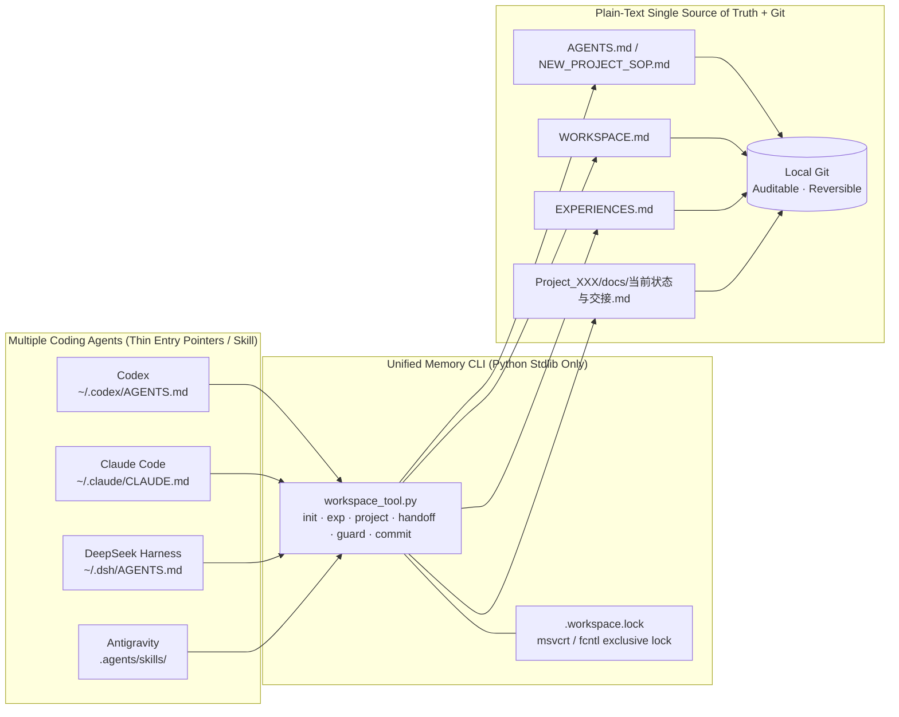
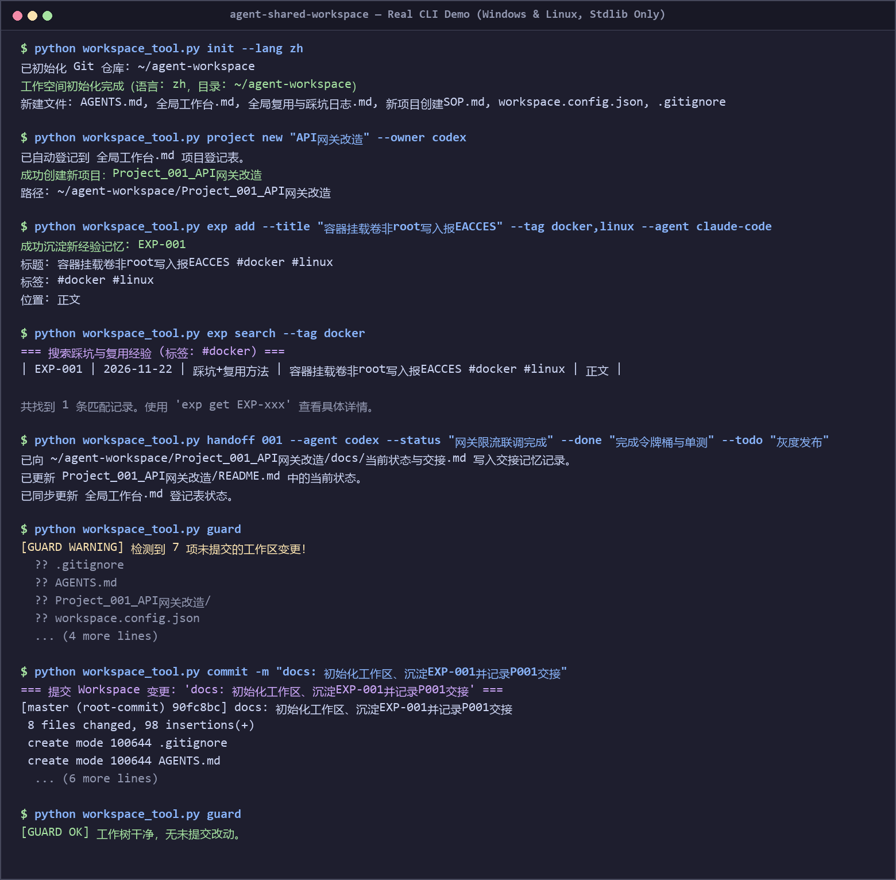

# Agent Shared Workspace

[](https://github.com/MAHONGHAO1/agent-shared-workspace/actions/workflows/tests.yml)
[](https://www.python.org/)
[](#)
[](LICENSE)

[中文](README.md) | **English**

**A dependency-free shared memory hub for multiple coding agents: plain-text Markdown SSOT + concurrency-safe CLI + Git versioning.**

---

## Why This Exists

If you run Codex, Claude Code, DeepSeek Harness, Antigravity, or other coding agents on the same codebase, each agent keeps its own isolated memory:

- Three agents hit the exact same bug three times.
- Yesterday's root-cause analysis disappears in today's session.
- Passing current project status between agents turns into repetitive copy-pasting.
- Vector-DB memory feels like a black box: hard to inspect, hard to edit, and easy to pollute silently.

This tool takes a simpler route: **shared memory lives in plain Markdown files inside a local workspace, every agent reads/writes through one stdlib-only CLI guarded by a cross-process file lock, and Git handles history and rollback.**

## Architecture



## Real CLI Output



## Quick Start

Zero third-party packages required (Python 3.9+ stdlib only):

```bash
# 1. Point to your workspace directory (defaults to cwd if unset)
export AGENT_WORKSPACE_ROOT=~/agent-workspace
# Windows PowerShell: $env:AGENT_WORKSPACE_ROOT="D:\agent-workspace"

# 2. Initialize skeleton files, workspace.config.json, .gitignore, and Git
python src/workspace_tool.py init --lang en

# 3. Create and register a project by SOP
python src/workspace_tool.py project new "ApiGateway" --owner codex

# 4. Record a tagged pitfall/experience
python src/workspace_tool.py exp add \
  --title "Non-root container fails with EACCES on bind mount" \
  --tag "docker,linux" \
  --phenomenon "Container process gets Permission denied writing to mounted volume" \
  --cause "Host directory is owned by root while container runs as uid 10001" \
  --solution "Set user: in compose or chown in entrypoint" \
  --criteria "Container successfully writes a 1 KB test file" \
  --agent "claude-code"

# 5. Search by keyword and/or tag
python src/workspace_tool.py exp search --tag docker
python src/workspace_tool.py exp search "EACCES" --tag linux
python src/workspace_tool.py exp get EXP-001

# 6. Record a structured handoff (syncs handoff doc, project README, and board)
python src/workspace_tool.py handoff 001 --agent "codex" \
  --status "Rate limiter verified" \
  --done "Implemented token bucket and 12 unit tests" \
  --evidence "tests/test_ratelimit.py 12/12" \
  --todo "Canary rollout"

# 7. Check for uncommitted changes and commit
python src/workspace_tool.py guard
python src/workspace_tool.py commit -m "docs: initialize workspace and log EXP-001"
```

## Commands

| Command | Purpose |
| --- | --- |
| `init [--lang zh\|en] [--no-git]` | Idempotently scaffold docs, `workspace.config.json`, `.gitignore`, and Git |
| `status [--guard]` | Show active projects and Git status; `--guard` exits with code 1 if dirty |
| `guard` | Lightweight dirty-tree check (exit 0 when clean, exit 1 when dirty) |
| `exp search [query] [--tag t] [--list-tags]` | Search experiences by keyword/tag or list all tags with counts |
| `exp get EXP-001` | Inspect index metadata and full entry body (or sink path) |
| `exp add --title ... [--tag a,b] [--sink 001]` | Append a new experience with auto-incremented ID and index update |
| `exp update EXP-001 --note ...` | Append new evidence to an existing experience instead of duplicating |
| `project list` | List all `Project_XXX_*` directories and highest ID |
| `project new <name> --owner <agent>` | Create a project directory, README, handoff file, and register it |
| `project update <id> --status ...` | Sync status to both project README and workspace board |
| `handoff <id> --agent ... --status ... --done ...` | Append a handoff record and atomically update README and board |
| `commit -m <message>` | Stage and commit workspace changes (automatically excludes `.workspace.lock`) |

## Built-in Safeguards

- **Cross-process Reentrant File Lock**: All write commands acquire `.workspace.lock` using `msvcrt.locking` on Windows and `fcntl.flock` on Linux/macOS. Concurrent agents serialize cleanly with zero ID collisions or torn Markdown. Timeout defaults to 10s (`AGENT_WORKSPACE_LOCK_TIMEOUT` to override).
- **Dirty-Tree Guard**: `guard` and `status --guard` return exit code `1` whenever uncommitted edits remain, suitable for shell hooks or end-of-session checks.
- **Configurable Filenames**: `init --lang en` writes `WORKSPACE.md` / `EXPERIENCES.md` / `NEW_PROJECT_SOP.md` and saves the mapping in `workspace.config.json`.

## Wiring Into Your Agents

Copy the short snippets from [`examples/AGENTS-snippet.md`](examples/AGENTS-snippet.md) into each agent's native instruction file:

| Agent | Entry File |
| --- | --- |
| Codex | `~/.codex/AGENTS.md` |
| Claude Code | `~/.claude/CLAUDE.md` |
| DeepSeek Harness | `~/.dsh/AGENTS.md` |
| Antigravity | `<workspace>/.agents/skills/shared-workspace/SKILL.md` (see [`examples/SKILL.md`](examples/SKILL.md)) |

Keep agent entry files thin (commands & triggers only). Do not paste full workspace docs into every system prompt.

## Why Not a Vector Database?

| Aspect | Vector RAG | This Approach |
| --- | --- | --- |
| Readability | Retrieved chunks, opaque ranking | Plain Markdown humans read and edit directly |
| Correctability | Requires re-embedding / re-indexing | Edit a paragraph or run `exp update` |
| Versioning | Separate snapshot tooling | Native Git diff, blame, and revert |
| Dependencies | Vector store + embedding service | Python stdlib only |
| Failure mode | Silently retrieves irrelevant memory | Explicit miss — visible and debuggable |

Trade-off: keyword, tag, and ID lookup only (no semantic similarity). Ideal for solo developers or small teams managing dozens to hundreds of verified lessons across multiple local agents.

## Tests & CI

```bash
python -m unittest discover -s tests -v
```

12 end-to-end tests run in isolated temp directories on both **Ubuntu** and **Windows** in GitHub Actions, including an **8-process concurrent write stress test** and a **lock-timeout verification test**.

## License

[MIT](LICENSE)
