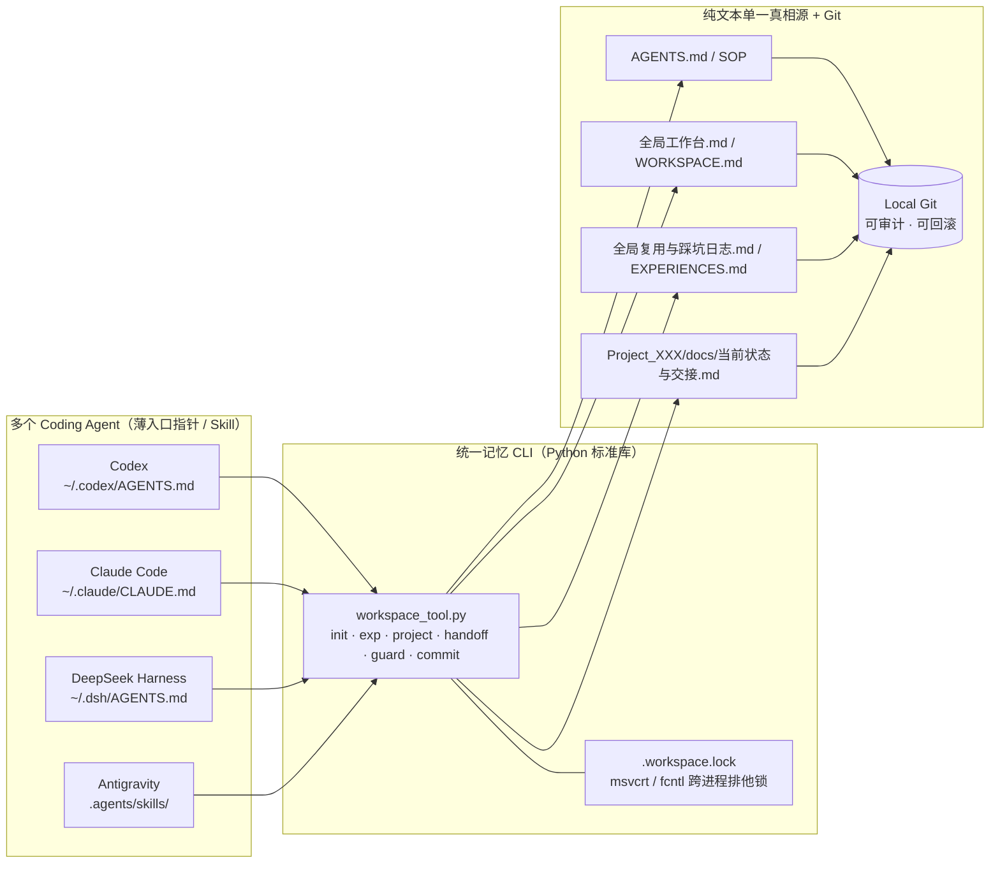
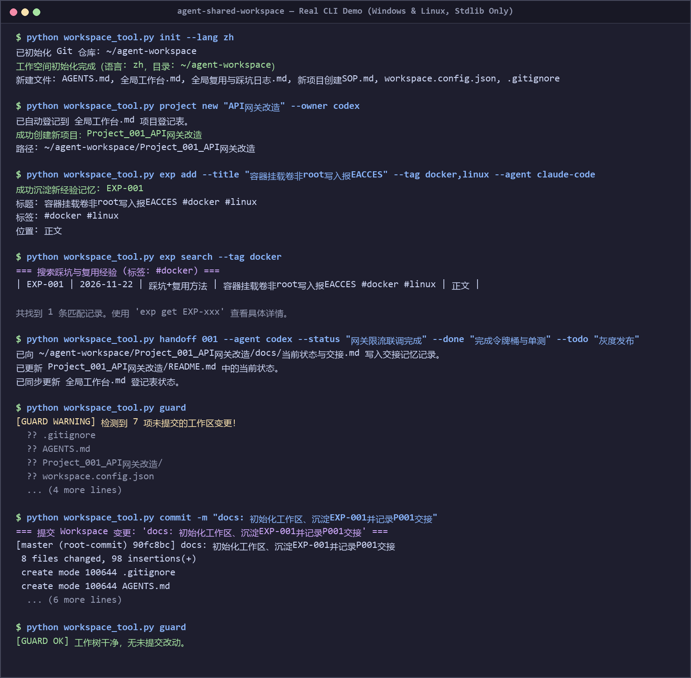

# Agent Shared Workspace

[](https://github.com/MAHONGHAO1/agent-shared-workspace/actions/workflows/tests.yml)
[](https://pypi.org/project/agent-shared-workspace/)
[](https://www.python.org/)
[](#)
[](LICENSE)

**中文** | [English](README.en.md)

**给多 Agent 用的一套共享记忆：纯文本 SSOT + 零依赖并发安全 CLI + Git 版本化。**

> **Status: experiment.** 这是一个个人工作流工具的公开版本，不是有 SLA 的产品。下一次复盘：2027-02-01。用之前先看「什么时候不该用」。

---

## 它解决什么问题

当你同时用 Codex、Claude Code、DeepSeek Harness、Antigravity 等多个 Coding Agent 做同一批项目时，它们各记各的，很快就会出现：

- 同一个坑，三个 Agent 踩三遍；
- 昨天的定位结论，今天换个 Agent 全部重来；
- 想把当前进度同步给下一个 Agent，只能反复复制粘贴；
- 上向量数据库做记忆，召回黑盒不可控，人既看不清它为什么想起这条，也很难直接改。

这套方案用最朴素的做法解决它：**记忆就是本地仓库里的几份 Markdown，所有 Agent 通过同一个零依赖 CLI（带跨进程文件锁）读写，Git 负责版本与回滚。**

## 什么时候不该用

- 你只用一个 Agent，且它已经能稳定读写 `AGENTS.md`；
- 你需要跨机器实时同步、权限控制、审计日志——那该用服务端或数据库；
- 你想要语义检索和自动召回，而不是人可读、可 diff 的文本。

它和普通 `AGENTS.md` 的区别：多了跨进程锁、带标签的经验检索、项目登记和交接记录。只需要一个静态说明文件的话，不需要它。

## 架构一览



## 实际运行效果



## 一键安装（4 种方式任选）

### 1. Agent Skill（`skills.sh` / Codex / Claude Code / Antigravity / Cursor）
```bash
npx skills add MAHONGHAO1/agent-shared-workspace
```
技能目录自带零依赖 `scripts/workspace_tool.py`，装完即可直接使用。

### 2. Claude Code 插件（含 Skill + MCP Server）
```text
/plugin marketplace add MAHONGHAO1/agent-shared-workspace
/plugin install agent-shared-workspace
```

### 3. MCP Server（零外部依赖，支持 Cursor / Claude Desktop / Antigravity）
无需 clone 仓库，直接通过 `uvx` 一行拉起：
```json
{
  "mcpServers": {
    "agent-shared-workspace": {
      "command": "uvx",
      "args": ["--from", "agent-shared-workspace", "agent-workspace-mcp"],
      "env": {
        "AGENT_WORKSPACE_ROOT": "/path/to/your-workspace"
      }
    }
  }
}
```
> 也可通过 `pip install agent-shared-workspace` 全局安装 `agent-workspace`（CLI）与 `agent-workspace-mcp`（MCP stdio Server）。

### 4. DeepSeek Harness 插件包
仓库内置即用型 DSh 插件包位于 [`integrations/deepseek-harness/`](integrations/deepseek-harness/)（包名 `dsh-agent-shared-workspace`，通过 `@deepseek-ai/dsh-skill-filesystem` 自动挂载共享记忆技能与 CLI）。

## 快速开始（30 秒跑通）

运行时零第三方依赖（Python 3.9+ 标准库）；先装 CLI：

```bash
uv tool install agent-shared-workspace   # 或 pip install agent-shared-workspace
agent-workspace --help
```

然后在你的共享工作空间目录里：

```bash
# 1. 指定你的共享工作空间目录（不设则默认当前目录）
export AGENT_WORKSPACE_ROOT=~/agent-workspace
# Windows PowerShell: $env:AGENT_WORKSPACE_ROOT="D:\agent-workspace"

# 2. 一键初始化骨架文档、workspace.config.json、.gitignore 与本地 Git
#    默认中文骨架（全局工作台.md 等）；英文骨架传 --lang en（WORKSPACE.md 等）
agent-workspace init --lang zh

# 3. 按 SOP 新建项目并自动登记
agent-workspace project new "API网关改造" --owner codex

# 4. 沉淀一条带标签的踩坑经验
agent-workspace exp add \
  --title "容器挂载卷非root写入报EACCES" \
  --tag "docker,linux" \
  --phenomenon "bind mount 后进程以 non-root 运行，创建目录报 Permission denied" \
  --cause "宿主机目录属主是 root，容器内 uid 10001 无写权限" \
  --solution "compose 里指定 user: 或 entrypoint 内 chown" \
  --criteria "容器内成功写入 1 KB 校验文件" \
  --agent "claude-code"

# 5. 按关键词或标签检索经验
agent-workspace exp search --tag docker
agent-workspace exp search "权限" --tag linux
agent-workspace exp get EXP-001

# 6. 记录阶段交接（自动同步交接文档、项目 README 与全局登记表）
agent-workspace handoff 001 --agent "codex" \
  --status "网关限流联调完成" \
  --done "完成令牌桶与 12 项单测" \
  --evidence "tests/test_ratelimit.py 12/12" \
  --todo "灰度发布"

# 7. 退出前巡检并固化到本地 Git
agent-workspace guard
agent-workspace commit -m "docs: 初始化工作区并沉淀 EXP-001"
```

> 在仓库里直接体验、不安装：把上面的 `agent-workspace` 换成 `python src/workspace_tool.py`。技能目录和 DSH 插件里的 `scripts/workspace_tool.py` 是同一份代码的副本，由 `python scripts/sync_cli.py` 生成；`--check` 会检查是否漂移。

## 目录结构（中英文自动对齐）

`init --lang zh` 与 `init --lang en` 会自动生成对应的 `workspace.config.json`，工具会按配置自动识别文件名，不再出现文档与代码不一致：

| 角色 | 中文骨架（`--lang zh`） | 英文骨架（`--lang en`） |
| --- | --- | --- |
| 规则入口 | `AGENTS.md` | `AGENTS.md` |
| 项目登记表 | `全局工作台.md` | `WORKSPACE.md` |
| 经验索引与正文 | `全局复用与踩坑日志.md` | `EXPERIENCES.md` |
| 建项规范 | `新项目创建SOP.md` | `NEW_PROJECT_SOP.md` |
| 文件名映射配置 | `workspace.config.json` | `workspace.config.json` |

```text
your-workspace/
├── AGENTS.md
├── workspace.config.json
├── 全局工作台.md              # 或 WORKSPACE.md
├── 全局复用与踩坑日志.md       # 或 EXPERIENCES.md
├── 新项目创建SOP.md            # 或 NEW_PROJECT_SOP.md
└── Project_001_API网关改造/
    ├── README.md
    └── docs/
        └── 当前状态与交接.md
```

## 命令一览

| 命令 | 作用 |
| --- | --- |
| `--version` | 打印 CLI 版本（main 分支已支持；PyPI 0.1.0 尚未包含） |
| `init [--lang zh\|en] [--no-git]` | 幂等初始化骨架文档、配置文件、`.gitignore` 与 Git（不覆盖已有文件） |
| `status [--guard]` | 查看进行中项目与 Git 状态；加 `--guard` 在有未提交改动时返回退出码 1 |
| `guard` | 轻量未提交巡检：干净返回 0，有未提交改动打印提醒并返回 1 |
| `exp search [关键词] [--tag 标签] [--list-tags]` | 按关键词、标签或组合检索经验，或列出全部标签统计 |
| `exp get EXP-001` | 查看指定经验的索引与正文详情（已下沉条目会提示目标路径） |
| `exp add --title ... [--tag a,b] [--sink P001]` | 沉淀新经验，自动分配连续编号、更新计数与索引（支持下沉到项目 docs） |
| `exp update EXP-001 --note ...` | 为已有经验追加新证据（同一问题不重复开条） |
| `project list` | 列出工作空间下所有项目及最大编号 |
| `project new <名称> --owner <agent>` | 按 SOP 建目录、生成 README 与交接文件，并自动登记 |
| `project update <编号> --status ...` | 同步更新项目 README 与全局登记表状态 |
| `handoff <编号> --agent ... --status ... --done ...` | 写入结构化交接，并原子同步 README 与登记表 |
| `commit -m <说明>` | 暂存并提交工作空间改动（自动排除临时锁文件 `.workspace.lock`） |

## 核心可靠性机制

1. **跨进程可重入文件锁（零外部依赖）**：所有写操作（`init` / `exp add` / `exp update` / `project new` / `project update` / `handoff` / `commit`）统一获取 `.workspace.lock` 排他锁（Windows 用 `msvcrt.locking`，Linux/macOS 用 `fcntl.flock`）。多 Agent 并发写自动排队串行，杜绝编号碰撞和 Markdown 撕裂；超时默认 10s（可通过 `AGENT_WORKSPACE_LOCK_TIMEOUT` 调整），且同进程嵌套调用可重入不死锁。
2. **脏工作树守卫（`guard` / `status --guard`）**：配合 shell hook 或 Agent 收尾约定，防止改完忘记 `commit`。
3. **标签不破坏原表格**：`--tag` 以 `#tag` 形式写入标题与正文元数据，保持原有 5 列 Markdown 表格完全向后兼容，人工 `grep` 同样直接命中。

## 接入各 Agent

把 [`examples/AGENTS-snippet.md`](examples/AGENTS-snippet.md) 里的短约定贴进各 Agent 的原生入口：

| Agent | 启动入口 |
| --- | --- |
| Codex | `~/.codex/AGENTS.md` |
| Claude Code | `~/.claude/CLAUDE.md` |
| DeepSeek Harness | `~/.dsh/AGENTS.md` |
| Antigravity | `<workspace>/.agents/skills/shared-workspace/SKILL.md`（见 [`examples/SKILL.md`](examples/SKILL.md)） |

> 原则：各 Agent 入口只放**什么时候调用哪个命令**的薄指针，不要把全局长文档整份塞进系统提示词，避免每轮开局白耗几千 token。

## 为什么不用向量数据库

| 维度 | 向量 RAG | 本方案 |
| --- | --- | --- |
| 可读性 | 召回碎片，人难核对来源 | 纯文本 Markdown，人直接读改 |
| 可修正性 | 改一条往往要重算 embedding / 重建索引 | 直接改一个段落或 `exp update` |
| 版本与回滚 | 需额外设计快照 | Git 原生 diff / blame / revert |
| 运行依赖 | 向量库 + embedding 模型/服务 | Python 标准库，零外部依赖 |
| 失败方式 | 静默召回不相关片段 | 查不到就是查不到，明确可见 |

代价也很透明：它只做关键词、标签与编号检索，不做语义相似度匹配。对**单人或小团队、几十到几百条经验**的本地多 Agent 协作非常顺手；超大规模知识库应考虑专业检索引擎。

## 测试与 CI

```bash
python -m unittest discover -s tests -v
cd integrations/deepseek-harness && npm run check
```

仓库内置 **15 项 Python 端到端测试 + 3 项 Node DSh 插件校验**（全部在临时目录运行，不碰真实工作区），在 GitHub Actions 上覆盖 **Ubuntu + Windows** 双平台矩阵：
- `init` 中英文骨架初始化与幂等性
- `exp add / update / search / --tag / --list-tags`
- `project new / handoff / status / guard / commit`
- **8 进程真实并发写压测**（验证文件锁串行化与编号连续无损）
- **锁持有超时退出验证**
- **MCP stdio JSON-RPC 全生命周期测试**（`initialize` / `tools/list` / `tools/call`）与多渠道清单同步校验

## 边界

- 面向单机、本地多 Agent 协作，不提供跨机器实时同步（跨机通过 Git push/pull 协作）。
- 不替代项目设计文档：交接只写当前状态、证据与下一步，详细方案留在项目 `docs/`。
- 不做黑盒自动提取：什么值得记由 Agent 或人判断，CLI 负责保证结构、编号、并发与版本一致。

## License

[MIT](LICENSE)
